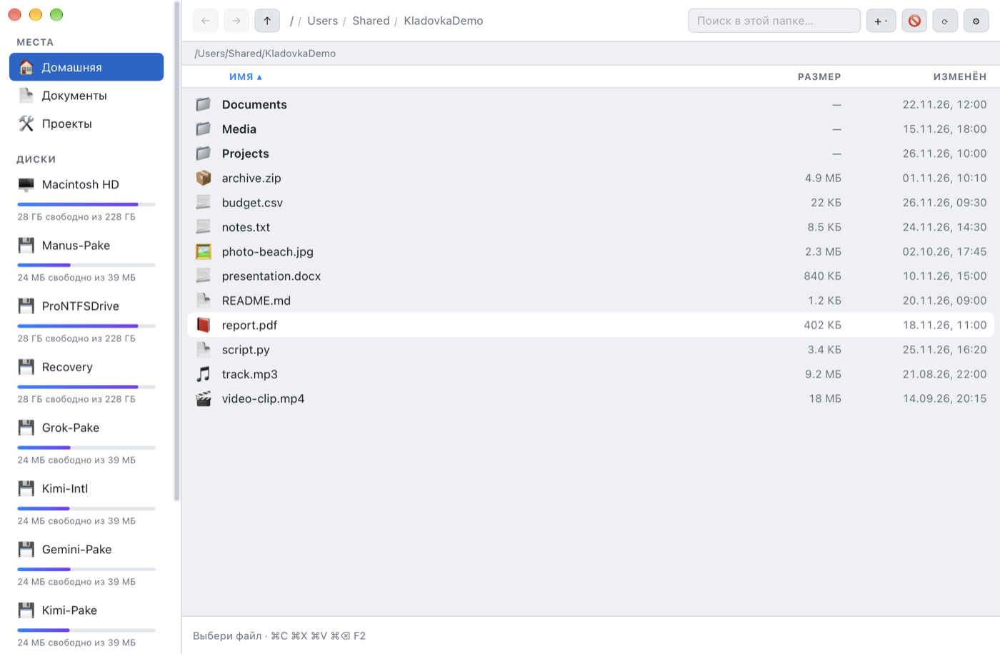

# Kladovka 🦝

**Native-feeling file manager for macOS, built with Tauri 2 + React.**
Fast, small (≈4.5 MB app), no Finder quirks, no terminal.

## Why

Finder gets in the way: no progress percentages for multi-file copies, no disk
panel, no cancel in the middle of an operation, no real keyboard workflow.
Kladovka does exactly that — and nothing it doesn't need.

## Screenshots

**Dark:**


**Light (follows the system, overridable in Settings):**



## Features

- **Disk sidebar** — all volumes (incl. external drives in `/Volumes`) with usage bars, free/total via `statvfs`
- **Real progress** — byte-level progress events for copy/move with a **Cancel** button per operation
- **Batch operations** — copy / move / rename / delete any selection in one action
- **Safe delete** — everything goes to the **macOS Trash** (recoverable), hard delete is an explicit choice
- **Create files** — txt, md, json, csv, py, rs, sh, html + **valid empty .docx / .xlsx** (real Office skeletons, not zero-byte files)
- **Search** — recursive name search with depth/count limits, non-blocking
- **Navigation** — breadcrumb path bar, back/forward history, symlink resolution
- **Sortable columns** — click Name / Size / Modified to sort, click again to reverse (folders always first, natural order: `file2` before `file10`)
- **Keyboard-first** — `↑↓` navigate, `Enter` open, `⌘C/⌘X/⌘V` clipboard, `F2` rename, `A` select all, `⌫` back
- **Context menu** — right-click for open / rename / copy / move / trash
- **Drag & drop** — drop files from Finder into Kladovka to copy them in
- **Light & dark theme** — follows the system, with a manual override in Settings
- **i18n** — Russian / English with auto-detection (⚙ in the toolbar)

## Tech

| Layer | Choice |
|---|---|
| Shell | Tauri 2 (Rust) |
| UI | React 19 + TypeScript + Vite |
| FS ops | `spawn_blocking` + progress events — UI never freezes on big copies |
| State | atomic swaps, no UI-blocking locks |
| Trash | native, via Finder (`osascript`) |

Rust commands: `list_dir`, `copy_paths`, `move_paths`, `trash_paths`,
`delete_paths`, `rename_path`, `create_dir`, `create_file`, `search_tree`,
`disk_info`, `cancel_op`, `open_path`, `reveal_path`.

## Build from source

Requirements: macOS, [Rust](https://rustup.rs), [pnpm](https://pnpm.io).

```bash
pnpm install
pnpm tauri build        # → src-tauri/target/release/bundle/dmg/
```

For development:

```bash
pnpm tauri dev
```

## Project layout

```
src/            React UI (App.tsx, i18n.ts, App.css)
src-tauri/src/  Rust core (lib.rs — all FS commands)
```

## License

MIT — see [LICENSE](LICENSE).
